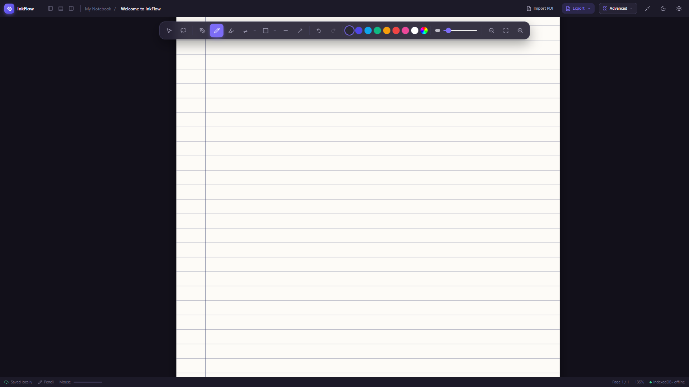

# InkFlow

**Professional digital handwriting and note-taking for graphics tablets and stylus pens.**
InkFlow pairs a high-performance, pressure-aware drawing engine with structured notebook management,
PDF annotation and fully offline storage — as a Tauri desktop app (React + TypeScript + Rust).

> **Download the latest portable build: [Releases](https://github.com/mostafa-abdo/InkFlow-app/releases/latest)**
> or view it online: [mostafa-abdo.github.io/InkFlow-app](https://mostafa-abdo.github.io/InkFlow-app/)


<p align="center"></p>

---

## Features

### Drawing engine
- **Tools**: Pen, Pencil, Highlighter, Eraser, Shapes (rectangle, ellipse, triangle, diamond, star), Line, Arrow, Lasso and object selection
- **Stylus-native input**: Pointer Events with `pressure`, `tiltX/tiltY`, `pointerId`, `pointer capture`, coalesced events and palm rejection (Windows Ink friendly)
- **Natural ink feel**: decimation + centred smoothing + quadratic mid-point curve fitting; per-segment pressure-variable width
- **Highlighter**: multiply blending with a scratch-buffer composite so segments don't compound opacity
- **Canvas stack**: background/template → PDF layer → committed ink → in-progress stroke → selection overlay
- **Viewport**: Ctrl+wheel zoom to cursor, wheel pan, Space/middle-mouse pan, zoom-to-fit
- **Editing**: lasso select, click select, move, resize with 8 handles, delete, full undo/redo history (move/resize/add/remove commands)
- **Efficient persistence**: strokes stored as gzip-compressed quantized payloads, one blob per page

### Notebooks & notes
- Notebooks, nested-ready folders, unlimited notes, multiple pages per note
- Tags, favorites, full-text search, duplicate, archive, per-note paper settings
- Page templates: blank, ruled, grid, dotted, Cornell, planner + custom background color
- Per-page paper overrides ("This page only"), custom background colors and spacing

### PDF annotation
- Import any PDF → each page becomes an annotatable page with the original rendered beneath your ink
- Annotations stored as a separate vector layer — the original PDF is never modified
- Export back to PDF with annotations drawn as vector operations (text stays selectable)

### Persistence & data safety
- SQLite via `tauri-plugin-sql` inside the desktop app (WAL-style journal, ACID transactions)
- IndexedDB twin implementation in the browser for development/preview — same contract, same semantics
- Automatic debounced autosave (configurable), flush on `pagehide`/`beforeunload`
- Crash recovery: pending stroke writes are journaled; interrupted saves are replayed on next launch
- One-click **backup** (`.inkflow.json`) and **restore** (fresh ids, never overwrites existing data)

### Export
- Current page as **PNG** (2×) or **SVG** (vector)
- Whole note as **PDF** — rasterized pages, or the original PDF re-saved with vector annotations on top
- Backup/restore of the entire workspace

### Interface
- Light/dark/system themes, configurable accent color
- Configurable keyboard shortcuts (record-by-pressing, with conflict-free rebinding UI, and sequence prefixes)
- **Three toolbar interfaces** — switch instantly from the top-bar button:
  - **Simple**: just Pen, Highlighter, Eraser, Undo/Redo, Colors and Stroke width — perfect for kids & quick notes
  - **Advanced**: every tool unlocked (the default)
  - **Custom**: your exact selection
- Every instrument (including undo/redo, zoom, colors, stroke width) can be toggled **per interface** in Settings → Interface, so nothing you don't need ever appears.

### Keyboard shortcuts (defaults)
| Combo | Action |
|---|---|
| `P` `B` `H` | Pen · Pencil · Highlighter |
| `E` `1`→`E+1` / `E` `2`→`E+2` | Eraser — whole strokes · Eraser — partial (touch only) |
| `V` `L` | Selection · Lasso |
| `S` | Shape (last used kind) — `S+1`..`S+5` = Rectangle · Ellipse · Triangle · Diamond · Star |
| `I` `A` | Line · Arrow |
| `Ctrl+Z` `Ctrl+Shift+Z` | Undo · Redo |
| `Ctrl+F` `Ctrl+D` `Delete` | Search · Duplicate note · Delete selection |
| `Ctrl+=` `Ctrl+-` `Ctrl+0` | Zoom in · out · 100% |
| `Ctrl+,` `Ctrl+Shift+E` `Ctrl+Shift+F` | Settings · Export PNG · Toggle favorite |

*Sequence shortcuts: press the prefix key, then the number within ~650 ms — e.g. `E` then `2` switches to the partial eraser.*
- Minimal, professional layout: sidebar (notebooks/folders/tags/search) · canvas workspace · inspector panel · page rail · status bar with live pressure meter

---

## Getting started

### Prerequisites
- Node.js 20+ and npm
- For the desktop build: [Rust](https://rustup.rs/) (stable) and the [Tauri 2 prerequisites](https://v2.tauri.app/start/prerequisites/) — MSVC Build Tools on Windows and WebView2 (already shipped with Windows)

> **Desktop build status:** the `src-tauri/` shell (Cargo.toml, `lib.rs`, capabilities, icons) is
> written to the standard Tauri 2 layout and the persistence layer's SQLite path is implemented,
> but a full `tauri build` has **not been compile-tested** — the machine this repo was developed on
> had no Rust toolchain or MSVC Build Tools. `npm run tauri:dev` should work after installing
> those two prerequisites; if anything drifts, it will be a one-line plugin/permission fix.

### Development (browser, no Rust required)

```bash
npm install
npm run dev          # http://127.0.0.1:7431
```

The app runs fully in the browser with IndexedDB persistence. All features work, including
autosave, crash recovery, PDF import/annotation and export.

### Desktop app (Tauri 2)

**Prerequisites on Windows**:
- [Rust](https://rustup.rs/) (stable)
- [Microsoft C++ Build Tools](https://aka.ms/vs/17/release/vs_BuildTools.exe) with the `Microsoft.VisualStudio.Workload.VCTools` component (installed via `winget install --id Microsoft.VisualStudio.2022.BuildTools --override "--add Microsoft.VisualStudio.Workload.VCTools --includeRecommended --passive"`)
- WebView2 — already shipped with Windows 10/11

```bash
npm run tauri:dev    # desktop window with hot reload
npm run tauri:build  # production installer (.msi and NSIS .exe)
```

The installer is produced in `src-tauri/target/release/bundle/`:
- `nsis/InkFlow_0.1.0_x64-setup.exe` — per-user NSIS installer
- `msi/InkFlow_0.1.0_x64_en-US.msi` — MSI installer for system-wide install

Double-click the installer, accept the defaults, and InkFlow appears in the Start menu like any other Windows app. Data lives in `%APPDATA%\com.inkflow.app\inkflow.db` (SQLite).

Inside Tauri, the same UI talks to SQLite (`sqlite:inkflow.db` in the app data directory)
through `@tauri-apps/plugin-sql`. The persistence backend is selected automatically at runtime
(`src/persistence/adapter.ts`).

### Quality gates

```bash
npm test             # vitest — engine, codec, geometry, hit-testing
npm run lint         # oxlint
npm run build        # tsc -b && vite build
```

---

## Architecture

```
src/
  app/                  (Root App, routing-free view switch, global shortcuts)
  components/           Shared primitives (Modal, ContextMenu)
  engine/               Framework-free drawing engine
    DrawingEngine.ts    Tool dispatch, viewport, selection, undo/redo, rAF rendering
    strokeRenderer.ts   Pressure-variable stroke renderer (+ SVG path export)
    smoothing.ts        Decimation + centred smoothing
    hitTest.ts          Segment/outline distance, lasso polygon selection
    geometry.ts         Vector math, bounding boxes, pressure scaling
    templates.ts        Page template rendering (ruled/grid/dotted/cornell/planner)
  persistence/          Storage layer
    adapter.ts          Runtime backend selection (SQLite in Tauri, IndexedDB in browser)
    tauriSqliteBackend.ts  SQLite via tauri-plugin-sql (WAL journal, ACID)
    indexedDbBackend.ts    IndexedDB implementation with identical semantics
    repository.ts       Domain API (notebooks/notes/pages/strokes/backup/recovery)
    codec.ts            Quantize → JSON → gzip stroke serialization
    schema.ts           SQLite DDL
  features/
    shell/              TitleBar, Sidebar (notebooks/folders/tags/search), StatusBar
    editor/             EditorCanvas (4-canvas stack), DrawingToolbar, PropertiesPanel,
                        PageStrip (live thumbnails), EditorView, engineRef, pointerBus
    pdf/                pdf.js integration (open/render), PDF import flow
    export/             PNG / SVG / PDF / annotated-PDF export pipelines
    settings/           Settings screen (theme, editing, shortcuts, storage, backup)
  state/store.ts        Zustand workspace + editor UI state (single source of truth)
src-tauri/              Tauri 2 Rust shell (window + sqlite plugin)
tools/generate-icons.cjs  Programmatic icon generator (SDF-drawn PNG + ICO)
```

**Key design decisions**

- *The engine is storage-agnostic.* `DrawingEngine` emits events (`strokes-changed`,
  `selection-changed`, `history-changed`, …); the React host maps them to the store and to the
  autosave scheduler. Engine tests run in plain Node.
- *Coarse-grained, atomic stroke commits.* A page's strokes are one gzipped payload rewritten
  transactionally — fast autosave with a tiny write amplification and no torn states.
- *Write-ahead journal.* `saveStrokePayload` journals the intent first, then commits;
  `recoverJournal()` replays the intent at startup, making crash loss a non-issue.
- *Two backends, one contract.* `IndexedDbBackend` mirrors `TauriSqliteBackend` method for
  method so browser development behaves exactly like the desktop app.

---

## Data model (SQLite)

`notebooks` · `folders` · `notes` · `pages` · `page_strokes` (page_id → gzipped payload) ·
`journal` (write-ahead) · `assets` (PDFs, base64-in-DB) · `settings` (key/value)

---

## Roadmap

The architecture is ready for: handwriting recognition/search (Arabic + English), shape
recognition, audio recording, multiple ink layers, version history, cloud sync, custom templates,
image insertion and text boxes. Core engine reliability landed first, intentionally.

## License

Proprietary — all rights reserved (adjust as needed).
